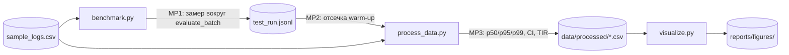

# Human Perception and Error Rates in AI-Generated Avatar Detection Under Time Constraints

[](LICENSE.md)
[](https://www.python.org/)

## Authors
* **Yugay Dmitriy** — *Student Researcher*
* **Nigai Maxim** — *Student Researcher*

---

## Project Overview & Research Aim

Репозиторий содержит экспериментальный стенд, пилотные логи, пайплайн статистической обработки и научную визуализацию
для исследования способности человека распознавать AI-сгенерированные аватары при ограничении времени просмотра.

### Key Research Questions
* **RQ1:** Снижает ли ограничение времени просмотра до **3 секунд** точность обнаружения ($Acc$) по сравнению с неограниченным просмотром?
* **RQ2:** Приводит ли дефицит времени к асимметричному росту ошибок? Положительный класс — AI-аватар, поэтому
  **FPR** — реальное лицо названо ИИ (гипер-скептицизм), **FNR** — ИИ названо реальным (неоправданное доверие).

> **Статус данных.** Реальных данных участников пока нет. Анализ выполнен на **пилотном сэмпле**
> (`data/sample/sample_logs.csv`: 8 проб в `3s_limit`, 2 в `unrestricted`), выводы по RQ1–RQ2 предварительные.
> Нагрузочный бенчмарк (латентность функции обработки проб) основан на реальных замерах `src/benchmark.py`.

---

## Repository Structure

```text
ai-avatar-perception-study/
├── data/
│   ├── raw/
│   │   ├── test_run.jsonl          # Сырые замеры: phase = warmup | benchmark (350 записей)
│   │   └── run_metadata.json       # Окружение (CPU, RAM, ОС, Python) и параметры запуска
│   ├── processed/
│   │   ├── metrics_summary.csv     # Метрики восприятия по условиям (Acc, FPR, FNR, d', RT, TIR + 95% CI)
│   │   ├── latency_by_load.csv     # Латентность p50/p95/p99 по уровням нагрузки + 95% CI
│   │   └── statistical_tests.csv   # Fisher exact, Mann–Whitney
│   └── sample/
│       └── sample_logs.csv         # Пилотные пробы участников
├── docs/
│   └── domain_model.md             # Доменная модель: LaTeX-формулы метрик + C4/Mermaid с точками замера
├── notebooks/
│   └── 01_data_analysis.ipynb      # Воспроизводимый анализ (выполнен, все выводы сохранены)
├── reports/
│   └── figures/                    # fig1..fig4 в .pdf (вектор) и .png (300 DPI)
├── src/
│   ├── common.py                   # Конфиг, пути, правило валидации, метаданные окружения
│   ├── benchmark.py                # Сбор замеров: warm-up + benchmark, JSONL
│   ├── process_data.py             # Фильтр warm-up, агрегация, бутстреп-CI, guardrail, тесты
│   └── visualize.py                # Публикационные графики
├── tests/
│   └── test_pipeline.py            # Тесты пайплайна и требований Task 3
├── config.yaml                     # Параметры эксперимента (seed, нагрузка, guardrails)
├── environment.yml / requirements.txt / Dockerfile
├── .gitignore
├── LICENSE.md
└── README.md
```

---

## Quickstart & Reproducibility Guide

Скрипты определяют корень проекта сами, поэтому их можно запускать из любой папки. Нужен Python 3.11+.

### Option 1: Native Python Environment

```bash
git clone https://github.com/DIMASUBMARINA/ai-avatar-perception-study.git
cd ai-avatar-perception-study

python -m venv .venv
# Windows:
.venv\Scripts\activate
# macOS/Linux:
source .venv/bin/activate

pip install -r requirements.txt

python src/benchmark.py       # -> data/raw/test_run.jsonl, run_metadata.json
python src/process_data.py    # -> data/processed/*.csv
python src/visualize.py       # -> reports/figures/*.pdf, *.png

# execute the notebook in place
jupyter nbconvert --to notebook --execute --inplace notebooks/01_data_analysis.ipynb

python -m pytest -q           # tests
```

### Option 2: Conda Environment

```bash
conda env create -f environment.yml
conda activate avatar-perception
python src/benchmark.py && python src/process_data.py && python src/visualize.py
```

### Option 3: Docker Container

```bash
docker build -t avatar-perception .
# resource limits reduce environment noise; outputs are mounted to the host
docker run --rm --cpus=1 --memory=512m -v "$(pwd)/data:/app/data" -v "$(pwd)/reports:/app/reports" avatar-perception
```

Случайность зафиксирована: `random_seed: 42` в `config.yaml` управляет выборкой пачек и бутстрепом
(`numpy.random.default_rng(42)`). Статистики и CI при повторной обработке одних и тех же данных совпадают;
абсолютные значения латентности зависят от машины и от запуска `benchmark.py`.

---

## Results & Discussion

### Методика
* **Warm-up:** на каждом уровне нагрузки 20 прогревочных прогонов (`phase="warmup"`) отбрасываются, анализируются 30 рабочих
  (`phase="benchmark"`), всего 210 замеров.
* **Статистика:** медиана (p25–p75), p95, p99, Mean±SD; 95% **бутстреп-CI** (перцентильный метод, B = 2000, seed 42).
* **Guardrail:** TIR (доля невалидных проб) учитывается отдельной метрикой, а не удаляется молча; порог — 15%.
  Для проверки guardrail в пул проб добавлен синтетический краевой случай (слишком быстрый ответ, 120 мс).
* **Выбросы:** IQR-флаг (1.5×IQR) без удаления записей, чтобы не вырезать реальные спайки нагрузки.

### Таблица 1. Baseline vs Proposed (пилотный сэмпл)

| Условие | N | Acc, % [95% CI] | FPR, % [95% CI] | FNR, % [95% CI] | d′ | RT, ms (Mean ± SD) | RT, ms Median (p25–p75) | TIR, % |
| :--- | :---: | :---: | :---: | :---: | :---: | :---: | :---: | :---: |
| Baseline — Unrestricted viewing | 2 | 100.0 [100.0; 100.0] | 0.0 [0.0; 0.0] | 0.0 [0.0; 0.0] | 1.35 | 3650 ± 778 | 3650 (3375–3925) | 0.0 |
| Proposed — 3-second limit | 8 | 75.0 [37.5; 100.0] | 25.0 [0.0; 75.0] | 25.0 [0.0; 75.0] | 1.05 | 1139 ± 182 | 1110 (1025–1275) | 0.0 |

Критерии: Fisher exact для точности — p = 1.00; Mann–Whitney U для времени ответа — p = 0.044
(`data/processed/statistical_tests.csv`). **Важно:** n = 8 и n = 2, поэтому CI очень широкие (для n = 2 интервал равен размаху),
а мощность тестов ничтожна. Значение p = 0.044 для RT — минимально достижимое при выборках 8 и 2 (2/C(10,2)),
поэтому оно не служит доказательством эффекта.

### Таблица 2. Латентность функции обработки проб (µs) по нагрузке

| Нагрузка, проб/пачка | N прогонов | Mean ± SD | Median (p25–p75) [95% CI] | p95 | p99 | Невалидных проб, % |
| :---: | :---: | :---: | :---: | :---: | :---: | :---: |
| 1 | 30 | 0.29 ± 0.04 | 0.28 (0.25–0.32) [0.27; 0.30] | 0.37 | 0.37 | 6.7 |
| 2 | 30 | 0.39 ± 0.07 | 0.36 (0.35–0.41) [0.35; 0.39] | 0.51 | 0.64 | 3.3 |
| 5 | 30 | 0.83 ± 0.17 | 0.81 (0.69–0.94) [0.70; 0.89] | 1.14 | 1.23 | 10.7 |
| 10 | 30 | 1.16 ± 0.10 | 1.15 (1.12–1.16) [1.13; 1.16] | 1.23 | 1.51 | 10.7 |
| 20 | 30 | 2.10 ± 0.46 | 1.97 (1.92–2.01) [1.93; 1.99] | 2.96 | 3.81 | 8.3 |
| 50 | 30 | 4.30 ± 0.14 | 4.27 (4.24–4.32) [4.24; 4.31] | 4.44 | 4.80 | 9.5 |
| 100 | 30 | 11.68 ± 4.11 | 11.37 (10.12–11.86) [10.92; 11.76] | 12.50 | 26.71 | 8.5 |

### Графики


*Fig. 1. Латентность (p50/p95/p99) vs нагрузка, лог-лог шкала; полосы — 95% бутстреп-CI.*


*Fig. 2. Распределение времени ответа по условиям; ромб — среднее с 95% CI.*


*Fig. 3. Точность обнаружения с 95% CI и уровнем случайного угадывания (50%).*


*Fig. 4. Асимметрия ошибок FPR vs FNR с 95% CI.*

### Обсуждение
1. **Латентность.** Медиана времени обработки растёт примерно линейно с нагрузкой (на лог-лог графике наклон около 1).
   Хвосты p95/p99 заметно шире медианы; наиболее тяжёлый хвост в этом запуске — при нагрузке 100 (p99/p50 ≈ 2).
   Такие единичные спайки типичны для планировщика ОС и сборщика мусора: они помечены IQR-флагом, но сохранены в данных.
   Guardrail TIR не нарушен ни на одном уровне (максимум 10.7% при пороге 15%).
2. **Холодный старт.** Максимальный эффект прогрева в этом запуске — ×1.22 к медиане при нагрузке 1;
   на больших пачках разница практически исчезает. Фильтрация warm-up всё равно обязательна.
3. **RQ1/RQ2 (предварительно).** В пилоте при 3-секундном лимите точность 75%
   (FPR = 25%, FNR = 25%), без лимита — 100%, но на двух пробах.
   Данных недостаточно для выводов; для проверки гипотез нужна реальная выборка (достаточно заменить `data/sample/sample_logs.csv`).
4. **Ограничения.** Малый n; синтетическая краевая проба в бенчмарке; запуск выполнен на одной машине
   (Linux, 1 CPU, 3.9 GB RAM, Python 3.12.3), поэтому абсолютные
   значения латентности нужно воспринимать как оценку для этой конфигурации.

---

## Domain Model

Формализация метрик (LaTeX, таблица обозначений) и контейнерная диаграмма пайплайна с точками замера — в
[`docs/domain_model.md`](docs/domain_model.md).



---

## Task 3 Compliance Checklist

| Требование | Где реализовано |
| :--- | :--- |
| Сырые замеры с warm-up и benchmark, ≥ 100 записей | `src/benchmark.py` → `data/raw/test_run.jsonl` |
| Параметры нагрузки в конфиге, метаданные окружения | `config.yaml`, `data/raw/run_metadata.json` |
| Фильтр warm-up, медиана, p95, p99, бутстреп-CI, guardrail | `src/process_data.py` → `data/processed/*.csv` |
| Воспроизводимый ноутбук (выполнен, seed 42, Markdown) | `notebooks/01_data_analysis.ipynb` |
| Научные графики: оси с единицами, 95% CI, colorblind + маркеры, PDF и PNG 300 DPI | `src/visualize.py` → `reports/figures/` |
| Доменная модель (LaTeX-формулы + C4/Mermaid) | `docs/domain_model.md` |
| `.gitignore` без checkpoints и дампов, артефакты не игнорируются | `.gitignore` |
| Автопроверка требований | `tests/test_pipeline.py` |

### Plot audit (чек-лист ss8)
- [x] Все оси подписаны с единицами (`Latency (µs)`, `Response time (ms)`, `Accuracy (%)`), `font_scale=1.2`, лог-шкала на fig1.
- [x] Неопределённость показана на каждом графике (полосы 95% CI, error bars, Mean ± CI).
- [x] Палитра `colorblind`, разные маркеры, штрихи и штриховка (читаемо в ч/б).

### Git workflow (финальный коммит и релиз)

```bash
git add src/ data/raw data/processed data/sample docs/ notebooks/ reports/figures/ config.yaml tests/ .gitignore README.md
git commit -m "Task 3: data analysis, scientific plots, domain model"
git push
git tag -a v3.0 -m "Task 3 final"
git push --tags
```

---

## Citation & License

```bibtex
@misc{yugay_nigai_avatar_perception_2026,
  author       = {Yugay, Dmitriy and Nigai, Maxim},
  title        = {Human Perception and Error Rates in AI-Generated Avatar Detection Under Time Constraints},
  year         = {2026},
  publisher    = {GitHub},
  howpublished = {\url{https://github.com/DIMASUBMARINA/ai-avatar-perception-study}}
}
```

Проект распространяется под лицензией [MIT](LICENSE.md).
