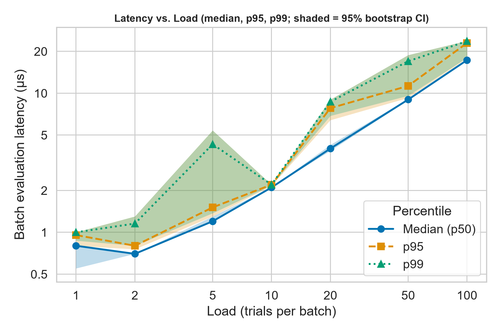
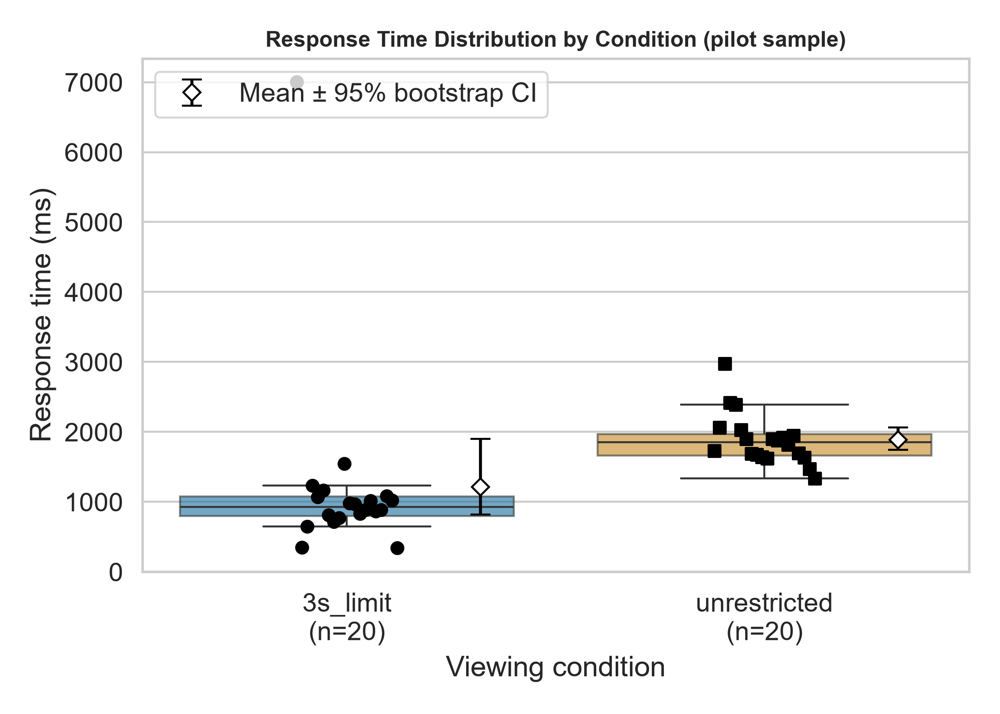
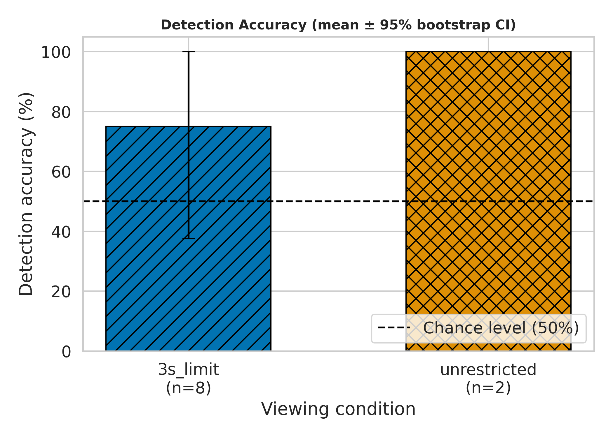
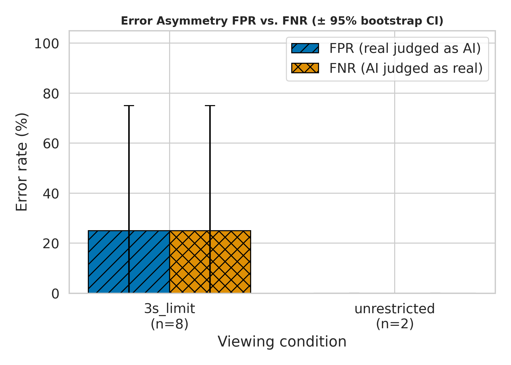
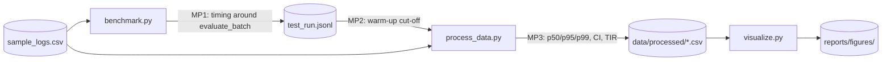

# Human Perception and Error Rates in AI-Generated Avatar Detection Under Time Constraints

[](LICENSE.md)
[](https://www.python.org/)

## Authors
* **Yugay Dmitriy** — *Student Researcher*
* **Nigai Maxim** — *Student Researcher*

---

## Project Overview & Research Aim

This repository contains an experiment platform, pilot logs, a statistical processing pipeline and scientific visualisation
for a study of how well people can recognise AI-generated avatars when viewing time is limited.

### Key Research Questions
* **RQ1:** Does limiting viewing time to **3 seconds** reduce detection accuracy ($Acc$) compared with unrestricted viewing?
* **RQ2:** Does time pressure lead to an asymmetric increase in errors? The positive class is the AI avatar, so
  **FPR** means a real face judged as AI (hyper-scepticism) and **FNR** means an AI face judged as real (unwarranted trust).

> **Data status.** There is no real participant data yet. The analysis was run on the **pilot sample**
> (`data/sample/sample_logs.csv`: 8 trials in `3s_limit`, 2 in `unrestricted`), so conclusions for RQ1–RQ2 are preliminary.
> The load benchmark (latency of the trial-processing function) is based on real measurements from `src/benchmark.py`.
> Real data is collected with the web experiment in [`web/`](web/README.md); how to connect its results is described in
> [Web experiment and connecting real data](#web-experiment-and-connecting-real-data).

---

## Repository Structure

```text
ai-avatar-perception-study/
├── web/                            # Web experiment for data collection (Node.js + Express), see web/README.md
├── data/
│   ├── real/                       # Real participant data (after import_web_data.py)
│   ├── raw/
│   │   ├── test_run.jsonl          # Raw measurements: phase = warmup | benchmark (350 records)
│   │   └── run_metadata.json       # Environment (CPU, RAM, OS, Python) and run parameters
│   ├── processed/
│   │   ├── metrics_summary.csv     # Perception metrics per condition (Acc, FPR, FNR, d', RT, TIR + 95% CI)
│   │   ├── latency_by_load.csv     # Latency p50/p95/p99 per load level + 95% CI
│   │   ├── statistical_tests.csv   # Fisher exact, Mann–Whitney (trials treated as independent, pilot only)
│   │   ├── participant_table.csv   # Metrics per participant and condition (participant_level.py)
│   │   └── participant_level_tests.csv   # Paired tests and participant-level bootstrap CIs
│   └── sample/
│       └── sample_logs.csv         # Pilot participant trials
├── docs/
│   └── domain_model.md             # Domain model: LaTeX metric formulas + C4/Mermaid with measurement points
├── notebooks/
│   └── 01_data_analysis.ipynb      # Reproducible analysis (executed, all outputs saved)
├── reports/
│   └── figures/                    # fig1..fig4 as .pdf (vector) and .png (300 DPI)
├── src/
│   ├── common.py                   # Config, paths, trial validation rules, environment metadata
│   ├── benchmark.py                # Measurement collection: warm-up + benchmark, JSONL
│   ├── process_data.py             # Warm-up filter, aggregation, bootstrap CI, guardrail, tests
│   ├── import_web_data.py          # Validate and copy the CSV from web/ to data/real/
│   ├── participant_level.py        # Participant-level analysis: paired tests, participant bootstrap
│   └── visualize.py                # Publication-quality figures
├── tests/
│   ├── test_pipeline.py            # Pipeline tests and Task 3 requirements
│   ├── test_integration.py         # Tests of the web data format, import and trial exclusion rules
│   ├── test_participant_level.py   # Tests of the participant-level analysis
│   └── fixtures/web_export_sample.csv   # Synthetic example of a web experiment export
├── config.yaml                     # Experiment parameters (seed, load, guardrails)
├── environment.yml / requirements.txt / Dockerfile
├── .gitignore
├── LICENSE.md
└── README.md
```

---

## Quickstart & Reproducibility Guide

The scripts locate the project root themselves, so they can be run from any folder. Python 3.11+ is required.

### Option 1: Native Python Environment

```bash
git clone https://github.com/DIMASUBMARINA/ai-avatar-perception-study.git
cd ai-avatar-perception-study

python -m venv .venv
# Windows:
.venv\Scripts\activate
# macOS/Linux:
source .venv/bin/activate

pip install -r requirements.txt

python src/benchmark.py       # -> data/raw/test_run.jsonl, run_metadata.json
python src/process_data.py    # -> data/processed/*.csv
python src/visualize.py       # -> reports/figures/*.pdf, *.png

# execute the notebook in place
jupyter nbconvert --to notebook --execute --inplace notebooks/01_data_analysis.ipynb

python -m pytest -q           # tests
```

### Option 2: Conda Environment

```bash
conda env create -f environment.yml
conda activate avatar-perception
python src/benchmark.py && python src/process_data.py && python src/visualize.py
```

### Option 3: Docker Container

```bash
docker build -t avatar-perception .
# resource limits reduce environment noise; outputs are mounted to the host
docker run --rm --cpus=1 --memory=512m -v "$(pwd)/data:/app/data" -v "$(pwd)/reports:/app/reports" avatar-perception
```

Randomness is fixed: `random_seed: 42` in `config.yaml` controls batch sampling and the bootstrap
(`numpy.random.default_rng(42)`). Statistics and CIs are identical when the same data is processed again;
absolute latency values depend on the machine and on the `benchmark.py` run.

---

## Web experiment and connecting real data

The [`web/`](web/README.md) folder contains the website that shows stimuli to participants and writes their answers to
`web/data/participant_trials.csv`. Analysis (Python) and data collection (Node.js) are separate: only this CSV file links them.

### 1. Data collection

```bash
cd web
npm install
# put images into web/stimuli/real and web/stimuli/ai (at least TRIALS_PER_BLOCK * 2 per class)
npm start                                    # http://localhost:3000
cloudflared tunnel --url http://localhost:3000   # public link for participants (second terminal window)
```

Before collecting data, delete `web/data/participant_trials.csv` if it still contains test runs.

### 2. Connecting to the analysis (after data collection is finished)

```bash
python src/import_web_data.py        # validates the format, prints a summary and copies to data/real/participant_trials.csv
```

Then switch one path in `config.yaml`:

```yaml
dataset:
  human_trials_path: "data/real/participant_trials.csv"
```

and run `python src/benchmark.py && python src/process_data.py && python src/participant_level.py && python src/visualize.py`, then execute the notebook again
(`jupyter nbconvert --to notebook --execute --inplace notebooks/01_data_analysis.ipynb`).
The `human_trials_path` setting is read by `process_data.py`, `visualize.py`, the notebook and `benchmark.py`; for a one-off run it can be
overridden with the `AVATAR_TRIALS_PATH` environment variable. The pilot file `data/sample/sample_logs.csv` stays in place:
the tests and the pilot tables below are built on it.

### 3. Response time and trial exclusion rules

In both conditions `response_time_ms` is measured from the moment the face and the answer buttons are painted, so response times are
comparable across conditions. In `3s_limit` the participant can answer immediately (the face disappears at the moment of the answer); if there is no
answer within 3 seconds, the face disappears by itself and the buttons stay. `exposure_ms` is how long the face was on screen.

A trial is invalid (`is_valid = False`) and is left out of the metrics, but it **is counted in TIR** (the share of invalid trials), if:

| Rule | Setting in `config.yaml` |
|---|---|
| response time below `min_valid_rt_ms` (200 ms), or above `max_valid_rt_ms` if one is set (no upper limit by default) | `guardrails.min_valid_rt_ms`, `max_valid_rt_ms` |
| the participant switched tabs (`focus_lost = 1`) | `guardrails.exclude_focus_lost: true` |
| in `3s_limit` the face stayed on screen longer than the limit + tolerance (timer failure) | `guardrails.max_exposure_overshoot_ms: 150` |

There is **no upper limit** on response time by default (`max_valid_rt_ms: null`), because without a time limit slow answers can be legitimate.
The consequence: a participant who leaves in the middle of a trial still counts, and very long times distort RT means and SDs, so use medians for response time.
If you want an upper limit, set `max_valid_rt_ms` (ms) globally or per condition (`max_valid_rt_ms_by_condition: {unrestricted: 60000}`).
Choose the values **before** looking at the real data and record them in the report: excluding slow trials in only one condition inflates its accuracy. As a control, `participant_table.csv` contains `accuracy_all_pct`
(accuracy over all trials without exclusions); if the conclusions change when exclusions are applied, this has to be discussed.
`import_web_data.py` shows the share of excluded trials per condition and reason. Rules are skipped when the required columns are missing (the pilot file);
`experiment.viewing_time_limit_ms` must match `VIEW_LIMIT_MS` of the web experiment.

### 4. Participant-level analysis (primary for real data)

Every participant takes part in both conditions, so the trials of one person are not independent. The script `src/participant_level.py` computes
accuracy, FPR, FNR and median response time per participant and condition, compares the conditions with a paired Wilcoxon test, tests accuracy
against 50% and builds bootstrap CIs over participants (not over trials):

```bash
python src/participant_level.py      # -> data/processed/participant_table.csv, participant_level_tests.csv
```

The primary RQ1 outcome is accuracy (`accuracy_pct`); the other metrics are exploratory and no correction for multiple comparisons is applied.
With fewer than 6 participants the script does not compute p-values and writes the reason in the `note` column. Table 1 below (`process_data.py`, `statistical_tests.csv`)
treats trials as independent and is suitable for the pilot only.

### 5. What to update in the report after switching to real data
* replace the "Data status" block and Table 1 in this README;
* the pilot file `data/sample/sample_logs.csv` has no `exposure_ms` or `focus_lost` and does not document how response time was measured:
  it must not be merged with the web experiment data.

---

## Results & Discussion

### Methodology
* **Warm-up:** at every load level 20 warm-up runs (`phase="warmup"`) are discarded and 30 working runs are analysed
  (`phase="benchmark"`), 210 measurements in total.
* **Statistics:** median (p25–p75), p95, p99, Mean±SD; 95% **bootstrap CI** (percentile method, B = 2000, seed 42).
* **Guardrail:** TIR (the share of invalid trials) is reported as a separate metric instead of being silently deleted; the threshold is 15%.
  To test the guardrail, a synthetic edge case (an answer that is too fast, 120 ms) is added to the trial pool.
* **Outliers:** an IQR flag (1.5×IQR) is used without deleting records, so that real load spikes are not cut out.

### Table 1. Baseline vs Proposed (pilot sample)

| Condition | N | Acc, % [95% CI] | FPR, % [95% CI] | FNR, % [95% CI] | d′ | RT, ms (Mean ± SD) | RT, ms Median (p25–p75) | TIR, % |
| :--- | :---: | :---: | :---: | :---: | :---: | :---: | :---: | :---: |
| Baseline — Unrestricted viewing | 2 | 100.0 [100.0; 100.0] | 0.0 [0.0; 0.0] | 0.0 [0.0; 0.0] | 1.35 | 3650 ± 778 | 3650 (3375–3925) | 0.0 |
| Proposed — 3-second limit | 8 | 75.0 [37.5; 100.0] | 25.0 [0.0; 75.0] | 25.0 [0.0; 75.0] | 1.05 | 1139 ± 182 | 1110 (1025–1275) | 0.0 |

Tests: Fisher exact for accuracy — p = 1.00; Mann–Whitney U for response time — p = 0.044
(`data/processed/statistical_tests.csv`). **Important:** n = 8 and n = 2, so the CIs are very wide (for n = 2 the interval equals the range)
and the power of the tests is negligible. The value p = 0.044 for RT is the smallest achievable with samples of 8 and 2 (2/C(10,2)),
so it is not evidence of an effect.

### Table 2. Latency of the trial-processing function (µs) by load

| Load, trials/batch | N runs | Mean ± SD | Median (p25–p75) [95% CI] | p95 | p99 | Invalid trials, % |
| :---: | :---: | :---: | :---: | :---: | :---: | :---: |
| 1 | 30 | 0.29 ± 0.04 | 0.28 (0.25–0.32) [0.27; 0.30] | 0.37 | 0.37 | 6.7 |
| 2 | 30 | 0.39 ± 0.07 | 0.36 (0.35–0.41) [0.35; 0.39] | 0.51 | 0.64 | 3.3 |
| 5 | 30 | 0.83 ± 0.17 | 0.81 (0.69–0.94) [0.70; 0.89] | 1.14 | 1.23 | 10.7 |
| 10 | 30 | 1.16 ± 0.10 | 1.15 (1.12–1.16) [1.13; 1.16] | 1.23 | 1.51 | 10.7 |
| 20 | 30 | 2.10 ± 0.46 | 1.97 (1.92–2.01) [1.93; 1.99] | 2.96 | 3.81 | 8.3 |
| 50 | 30 | 4.30 ± 0.14 | 4.27 (4.24–4.32) [4.24; 4.31] | 4.44 | 4.80 | 9.5 |
| 100 | 30 | 11.68 ± 4.11 | 11.37 (10.12–11.86) [10.92; 11.76] | 12.50 | 26.71 | 8.5 |

### Figures


*Fig. 1. Latency (p50/p95/p99) vs load, log-log scale; bands show 95% bootstrap CIs.*


*Fig. 2. Distribution of response time by condition; the diamond is the mean with a 95% CI.*


*Fig. 3. Detection accuracy with 95% CIs and the chance level (50%).*


*Fig. 4. Error asymmetry, FPR vs FNR, with 95% CIs.*

### Discussion
1. **Latency.** The median processing time grows roughly linearly with load (a slope of about 1 on the log-log plot).
   The p95/p99 tails are clearly wider than the median; the heaviest tail in this run is at load 100 (p99/p50 ≈ 2).
   Such isolated spikes are typical for the OS scheduler and the garbage collector: they are marked with the IQR flag but kept in the data.
   The TIR guardrail is not violated at any level (maximum 10.7% against a 15% threshold).
2. **Cold start.** The largest warm-up effect in this run is ×1.22 on the median at load 1;
   with larger batches the difference practically disappears. Warm-up filtering is still mandatory.
3. **RQ1/RQ2 (preliminary).** In the pilot, accuracy under the 3-second limit is 75%
   (FPR = 25%, FNR = 25%) and without a limit it is 100%, but on only two trials.
   The data is not sufficient for conclusions; testing the hypotheses requires a real sample (it is enough to point `dataset.human_trials_path` in `config.yaml` to the real file).
4. **Limitations.** Small n; a synthetic edge-case trial in the benchmark; the run was executed on a single machine
   (Linux, 1 CPU, 3.9 GB RAM, Python 3.12.3), so absolute
   latency values should be read as an estimate for this configuration.

---

## Domain Model

The formalisation of the metrics (LaTeX, table of notation) and the container diagram of the pipeline with measurement points are in
[`docs/domain_model.md`](docs/domain_model.md).



---

## Task 3 Compliance Checklist

| Requirement | Where implemented |
| :--- | :--- |
| Raw measurements with warm-up and benchmark, ≥ 100 records | `src/benchmark.py` → `data/raw/test_run.jsonl` |
| Load parameters in a config, environment metadata | `config.yaml`, `data/raw/run_metadata.json` |
| Warm-up filter, median, p95, p99, bootstrap CI, guardrail | `src/process_data.py` → `data/processed/*.csv` |
| Reproducible notebook (executed, seed 42, Markdown) | `notebooks/01_data_analysis.ipynb` |
| Scientific figures: axes with units, 95% CI, colour-blind-safe palette + markers, PDF and PNG 300 DPI | `src/visualize.py` → `reports/figures/` |
| Domain model (LaTeX formulas + C4/Mermaid) | `docs/domain_model.md` |
| `.gitignore` without checkpoints and dumps, artefacts are not ignored | `.gitignore` |
| Automatic requirement checks | `tests/test_pipeline.py` |

### Plot audit (checklist ss8)
- [x] All axes are labelled with units (`Latency (µs)`, `Response time (ms)`, `Accuracy (%)`), `font_scale=1.2`, log scale on fig1.
- [x] Uncertainty is shown on every plot (95% CI bands, error bars, Mean ± CI).
- [x] `colorblind` palette, different markers, dashes and hatching (readable in black and white).

### Git workflow (final commit and release)

```bash
git add src/ data/raw data/processed data/sample docs/ notebooks/ reports/figures/ config.yaml tests/ .gitignore README.md
git commit -m "Task 3: data analysis, scientific plots, domain model"
git push
git tag -a v3.0 -m "Task 3 final"
git push --tags
```

---

## Citation & License

```bibtex
@misc{yugay_nigai_avatar_perception_2026,
  author       = {Yugay, Dmitriy and Nigai, Maxim},
  title        = {Human Perception and Error Rates in AI-Generated Avatar Detection Under Time Constraints},
  year         = {2026},
  publisher    = {GitHub},
  howpublished = {\url{https://github.com/DIMASUBMARINA/ai-avatar-perception-study}}
}
```

The project is distributed under the [MIT](LICENSE.md) license.
