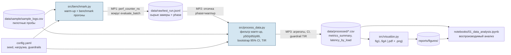

# Domain Model

Артефакт Task 3 (Week 9). Содержит **формализацию метрик (LaTeX)** — вариант для ML/AI-трека — и
**контейнерную диаграмму пайплайна с точками замера метрик** (Mermaid, вариант C4 для SE-трека).

## 1. Формализация метрик (Signal Detection Theory)

Исследуется способность человека отличать AI-сгенерированные аватары от реальных фото при ограничении времени
просмотра. Каждая проба $i$ описывается тройкой $(y_i, \hat{y}_i, t_i)$.

**Соглашение:** положительный класс — AI-аватар ($y=1$), отрицательный — реальное лицо ($y=0$).

$$
TP=\sum_i \mathbb{1}[y_i=1,\hat{y}_i=1],\quad
TN=\sum_i \mathbb{1}[y_i=0,\hat{y}_i=0],\quad
FP=\sum_i \mathbb{1}[y_i=0,\hat{y}_i=1],\quad
FN=\sum_i \mathbb{1}[y_i=1,\hat{y}_i=0]
$$

### Функция потерь (0–1 loss) и целевые метрики

$$
L(y,\hat{y}) = \mathbb{1}[y \neq \hat{y}], \qquad
Acc = 1 - \frac{1}{N}\sum_{i=1}^{N} L(y_i,\hat{y}_i) = \frac{TP+TN}{TP+TN+FP+FN}
$$

$$
FPR = \frac{FP}{FP+TN}\ \ (\text{реальное лицо названо ИИ}), \qquad
FNR = \frac{FN}{TP+FN}\ \ (\text{ИИ названо реальным})
$$

### Чувствительность $d'$ (с лог-линейной коррекцией Хаутуса)

$$
HR=\frac{TP+0.5}{TP+FN+1},\qquad FAR=\frac{FP+0.5}{FP+TN+1},\qquad
d' = \Phi^{-1}(HR)-\Phi^{-1}(FAR)
$$

### Guardrail-метрика (доля невалидных проб)

$$
TIR=\frac{\left|\{i:\ t_i<t_{min}\ \lor\ t_i>t_{max}\}\right|}{N}\cdot 100\%,\qquad TIR \le 15\%
$$

Невалидные пробы **не удаляются молча** (иначе selection bias), а учитываются в $TIR$.

### Задержка и неопределённость

$$
\ell_{p}=Q_p(\{L_j\}),\quad p\in\{50,95,99\};\qquad
CI_{95\%}=\left[\,\hat\theta^{*}_{(0.025)},\ \hat\theta^{*}_{(0.975)}\,\right]
$$

где $\hat\theta^{*}_{(q)}$ — $q$-квантиль бутстреп-распределения статистики по $B=2000$ ресэмплам с возвращением
(`numpy.random.default_rng(42)`).

### Таблица обозначений

| Символ | Значение | Единицы |
| :--- | :--- | :---: |
| $y_i \in \{0,1\}$ | Истинный класс стимула (1 = AI-аватар) | — |
| $\hat{y}_i \in \{0,1\}$ | Ответ участника | — |
| $t_i$ | Время ответа (response time) | ms |
| $t_{min}, t_{max}$ | Границы валидного времени ответа (200 и 15000) | ms |
| $N$ | Число валидных проб в условии | — |
| $TP, TN, FP, FN$ | Элементы матрицы ошибок | — |
| $Acc$ | Точность обнаружения | % |
| $FPR, FNR$ | Доли ложных срабатываний / пропусков | % |
| $d'$ | Индекс чувствительности SDT | — |
| $\Phi^{-1}$ | Квантильная функция стандартного нормального распределения | — |
| $TIR$ | Trial Invalidity Rate (guardrail) | % |
| $L_j$ | Латентность вызова `evaluate_batch` в прогоне $j$ | µs |
| $Q_p$ | Эмпирический $p$-перцентиль | как у аргумента |
| $B$ | Число бутстреп-итераций | — |
| $CI_{95\%}$ | Бутстреп-доверительный интервал 95% | как у метрики |

## 2. Контейнерная диаграмма (C4, Container level) с точками замера

### Точки сбора метрик (Measurement Points)

| ID | Где | Что измеряется | Метрика |
| :--- | :--- | :--- | :--- |
| MP1 | `benchmark.py`, `time.perf_counter_ns()` вокруг `evaluate_batch` | Чистое время обработки пачки (I/O вне таймера) | `batch_latency_us` |
| MP2 | `process_data.filter_warmup` | Отсечка холодного старта | `phase == "warmup"` отбрасывается |
| MP3 | `process_data.aggregate_*` | Агрегация, бутстреп-CI, guardrail | `p50/p95/p99`, `ci95_*`, `tir_pct`, `error_rate_pct` |
