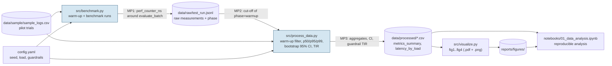

# Domain Model

Task 3 artefact (Week 9). It contains the **formalisation of the metrics (LaTeX)** — the ML/AI-track option — and a
**container diagram of the pipeline with metric measurement points** (Mermaid, the C4 option for the SE track).

## 1. Formalisation of the metrics (Signal Detection Theory)

The study examines how well a person can tell AI-generated avatars from real photos when viewing time is limited.
Each trial $i$ is described by the triple $(y_i, \hat{y}_i, t_i)$.

**Convention:** the positive class is the AI avatar ($y=1$), the negative class is the real face ($y=0$).

$$
TP=\sum_i \mathbb{1}[y_i=1,\hat{y}_i=1],\quad
TN=\sum_i \mathbb{1}[y_i=0,\hat{y}_i=0],\quad
FP=\sum_i \mathbb{1}[y_i=0,\hat{y}_i=1],\quad
FN=\sum_i \mathbb{1}[y_i=1,\hat{y}_i=0]
$$

### Loss function (0–1 loss) and target metrics

$$
L(y,\hat{y}) = \mathbb{1}[y \neq \hat{y}], \qquad
Acc = 1 - \frac{1}{N}\sum_{i=1}^{N} L(y_i,\hat{y}_i) = \frac{TP+TN}{TP+TN+FP+FN}
$$

$$
FPR = \frac{FP}{FP+TN}\ \ (\text{real face judged as AI}), \qquad
FNR = \frac{FN}{TP+FN}\ \ (\text{AI face judged as real})
$$

### Sensitivity $d'$ (with the Hautus log-linear correction)

$$
HR=\frac{TP+0.5}{TP+FN+1},\qquad FAR=\frac{FP+0.5}{FP+TN+1},\qquad
d' = \Phi^{-1}(HR)-\Phi^{-1}(FAR)
$$

### Guardrail metric (share of invalid trials)

$$
TIR=\frac{\left|\{i:\ t_i<t_{min}\ \lor\ t_i>t_{max}\}\right|}{N}\cdot 100\%,\qquad TIR \le 15\%
$$

Invalid trials are **not deleted silently** (that would cause selection bias); they are counted in $TIR$.
For data from the web experiment, a trial is additionally invalid if the participant switched tabs or if the face stayed on screen
longer than the time limit plus a tolerance (see the main `README.md`); the upper bound $t_{max}$ may be set per condition.

### Latency and uncertainty

$$
\ell_{p}=Q_p(\{L_j\}),\quad p\in\{50,95,99\};\qquad
CI_{95\%}=\left[\,\hat\theta^{*}_{(0.025)},\ \hat\theta^{*}_{(0.975)}\,\right]
$$

where $\hat\theta^{*}_{(q)}$ is the $q$-quantile of the bootstrap distribution of the statistic over $B=2000$ resamples with replacement
(`numpy.random.default_rng(42)`).

### Table of notation

| Symbol | Meaning | Units |
| :--- | :--- | :---: |
| $y_i \in \{0,1\}$ | True class of the stimulus (1 = AI avatar) | — |
| $\hat{y}_i \in \{0,1\}$ | Participant's answer | — |
| $t_i$ | Response time | ms |
| $t_{min}, t_{max}$ | Bounds of a valid response time (200 and 15000) | ms |
| $N$ | Number of valid trials in the condition | — |
| $TP, TN, FP, FN$ | Entries of the confusion matrix | — |
| $Acc$ | Detection accuracy | % |
| $FPR, FNR$ | False positive / false negative rates | % |
| $d'$ | SDT sensitivity index | — |
| $\Phi^{-1}$ | Quantile function of the standard normal distribution | — |
| $TIR$ | Trial Invalidity Rate (guardrail) | % |
| $L_j$ | Latency of the `evaluate_batch` call in run $j$ | µs |
| $Q_p$ | Empirical $p$-th percentile | same as the argument |
| $B$ | Number of bootstrap iterations | — |
| $CI_{95\%}$ | 95% bootstrap confidence interval | same as the metric |

## 2. Container diagram (C4, Container level) with measurement points

### Metric collection points (Measurement Points)

| ID | Where | What is measured | Metric |
| :--- | :--- | :--- | :--- |
| MP1 | `benchmark.py`, `time.perf_counter_ns()` around `evaluate_batch` | Pure batch processing time (I/O outside the timer) | `batch_latency_us` |
| MP2 | `process_data.filter_warmup` | Cold-start cut-off | `phase == "warmup"` is discarded |
| MP3 | `process_data.aggregate_*` | Aggregation, bootstrap CI, guardrail | `p50/p95/p99`, `ci95_*`, `tir_pct`, `error_rate_pct` |
